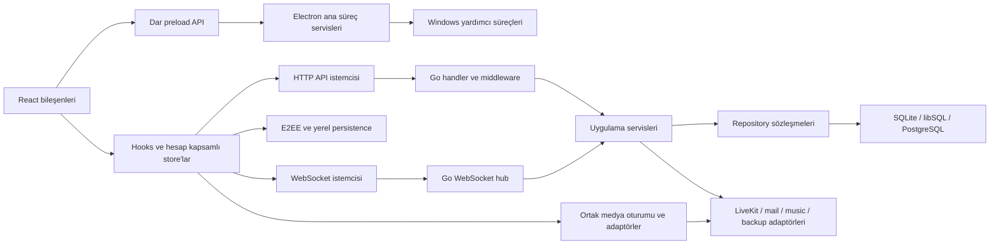

# Mimari iyileştirme kararları

26 Ekim uygulama kanıtı: ilk grup yerelde doğrulandı. Güncel sonuçlar ve kalan kabul sınırları [görev izleme tablosunda](REFACTORING_TASKS.md) ve [manifestli raporda](../implementation/verification/refactoring-implementation-2026-10-26.json) izlenir. Bu belge tüm görevlerin tamamlandığını göstermez.

Tarih: 25 Ekim 2026. Kaynak: `313acf8e` HEAD'i ve inceleme sırasında değişen yerel çalışma ağacı. Bu belge uygulanmış mimari değişiklik bildirimi değil, [RF görevleri](REFACTORING_TASKS.md) için uygulanabilir karar kaydıdır. 26 Ekim kullanıcı talebiyle aşağıdaki kararların ilk bölümü uygulanmaya başladı; görev bazlı durum REFACTORING_TASKS.md içindedir. Yerel uygulama/test değişiklikleri ile üretim kabulü ayrı izlenir.

## 1. Korunacak mimari ve değişim sınırı

HiChat, React/TypeScript/Zustand istemcisi, Electron masaüstü kabuğu, Capacitor mobil kabukları, Go HTTP/WebSocket backend'i, SQLite/libSQL/PostgreSQL repository katmanı ve LiveKit/P2P medya yollarından oluşan bir üründür. Native Windows yardımcıları ses yakalama ve oyun/pencere bilgisi sağlar. Music pipeline yt-dlp/ffmpeg ve LiveKit ile; mail, backup ve telemetry ise ayrı servislerle bütünleşir.

**Karar:** modüler monolit ve mevcut araçlar korunur. Microservice ayrımı, ORM, genel DI container, yeni state-management framework'ü veya kriptografik protokol değişikliği önerilmiyor. İyileştirme, sahiplik ve test sınırlarını netleştiren küçük PR'larla ilerler.

Şema hedef bağımlılık yönünü gösterir; mevcut kodun her yerde bu kurala uyduğunu iddia etmez. Domain davranışı taşıyan store/service'ler altyapı detaylarını dar adaptörler üzerinden kullanır. Adaptörün görevi dönüşüm ve kaynak sahipliği; uygulama kararının görevi yetki, sıra, hata ve state geçişidir.

Korunacak sözleşmeler:

- HTTP yolları, status kodları, JSON alanları, cookie davranışı ve pagination sırası; mevcut golden/OpenAPI ve tüketici testleri değişiklik öncesi sabitlenir.
- WebSocket `op`/payload, ordering/revision, bot/human ayrımı, session revocation ve permission filtreleri.
- Electron IPC kanal/payload ve sender/frame/session kontrolleri; native executable pipe formatı.
- E2EE ciphertext/backup sürümleri, algoritma/KDF parametre yorumlama, replay kontrolleri, hesap/cihaz kapsamı ve recovery uyumluluğu.
- DB veri formatları ve geçmiş migration'lar. Şema ihtiyacı ayrı migration, upgrade fixture'ı ve geri alma/restore planıyla ele alınır; geçmiş SQL dosyaları değiştirilmez.

Yeni iç fonksiyon/type/interface mevcut public façade arkasına eklenebilir. Dış sözleşme değişikliği refactoring PR'ına gizlenmez; ayrı gerekçe ve uyumluluk kararı gerektirir.

## 2. Backend: composition, transaction ve lifecycle

### Domain sınırları ve bağımlılık enjeksiyonu — RF10, RF11

`server/init_services.go:179` bütün servisleri sıralı kuruyor; `:329–341` ve `:384–406` capability assertion/setter örnekleri taşıyor. Mevcut handler → service → repository yönü korunacak; identity/account, social/messaging, voice/music ve operations grupları için küçük composition yardımcıları çıkarılacak. Her yardımcı yalnız kendi nesnelerini ve dışarı sunduğu yetenekleri döndürecek.

Zorunlu bağımlılıklar named narrow interface ve constructor parametresi olacak. Gerçek dependency döngüsü varsa ikinci wiring fazı açıkça tutulacak ve bootstrap testi eksik bağlantıyı reddedecek. Opsiyonel mail gibi entegrasyonlar konfigürasyondan gelen açık enabled/disabled durumuna sahip olacak. İhtiyaç duyulmayan genel abstraction veya interface üretimi yapılmayacak.

Music'te `music_bot_service.go:103`, `:195` üzerindeki durum üç sorumluluğa ayrılacak: saf kuyruk/state geçişleri; durable session persistence ve revision; connection/playback/subprocess yaşam döngüsü. Mevcut façade korunacak. Lock sırası ve ownership önce yazılı invariants ve yarış testleriyle sabitlenecek; sadece fonksiyonları farklı dosyalara taşımak tamamlanma ölçütü olmayacak. Restore sonrası kendiliğinden ses yayını başlamaması ve requester privacy fence korunacak.

### Kaynak sahipliği — RF08, RF14, RF19, RF20

| Kaynak | Sahip | Başlatma / kapatma kararı | Zorunlu doğrulama |
|---|---|---|---|
| Go auth sweep ve diğer worker'lar | Uygulama yaşam döngüsü; servis kendi worker durumunu tutar | Constructor goroutine başlatmaz; explicit start root context alır; stop idempotent ve bounded drain yapar | Çift start/stop, cancel sırasında iş, race, kalan goroutine |
| DB bağlantı havuzu | Bootstrap | Başarısız ping/migration sonunda kapatılır; başarılı kurulum ownership'i uygulamaya devreder | Failure injection, migration rollback, context deadline |
| WS bağlantı ve send queue | Bağlantı oturumu/hub | Mevcut `done` kapanış modeli korunur; üretici send kanalını kapatmaz | Full queue, concurrent send/shutdown, revoke/reconnect |
| Music subprocess ve LiveKit room | İlgili channel bot oturumu | Stop/timeout/privacy revocation aynı cleanup yolunu kullanır; timer ve subprocess birlikte sonlandırılır | Stop/restore/idle yarışları, yarım connect ve process exit |
| Browser MediaStream/Worker/AudioContext | Medya oturum controller'ı | Sahip oluşturduğu kaynağı kapatır; ödünç alınan track'i sahipmiş gibi durdurmaz | İzin reddi, unmount, track-ended, restart, stale completion |
| Electron listener/timer/window | İlgili registrar/controller | Kurulum dispose döndürür; shutdown/navigation/destroy sözleşmesi açık | Çift setup, renderer destroy, tekrar mount ve listener sayısı |

`auth_service.go:326–345` iptal edilemeyen ticker'ın ilk hedefidir; `database.go:183–191` açılış hatası cleanup hedefidir. Mevcut `context.Background()` çağrılarının tamamı mekanik olarak request context'e çevrilmez: commit sonrası drain veya bağımsız worker işi uygulama context'i ve kendi timeout'una ihtiyaç duyabilir.

### Hata ve logging sınırı — RF24

Domain katmanı typed/sentinel hata döndürür; handler HTTP dönüşümünü tek noktadan yapar; kullanıcıya iç driver/subprocess/secret ayrıntısı aktarılmaz. `errors.Is` ve `%w` zinciri korunur. İşlemi terminal olarak raporlayan katman belirlenir; aynı hata service, middleware ve global logger tarafından tekrar tekrar kaydedilmez. Request ID, component ve event code korelasyon içindir; raw token, DSN, özel mesaj veya key içeriği loglanmaz.

Mevcut çalışma ağacında `logx`, app log batching, middleware ve diagnostics migration'ları üzerinde değişiklikler vardır. Önce bunlar incelenip test edilmelidir; paralel ikinci logging mimarisi kurulmaz. Backpressure, dropped-event sayısı, batch flush ve shutdown deadline ölçülür; logging ana request yolunu sınırsız bekletemez. Nominal başarı ve hata/fallback kanıtı ayrı tutulur.

## 3. Veri katmanı ve sorgu performansı

### Üç backend'in sorumluluğu — RF04, RF05

SQLite, libSQL ve PostgreSQL destekleri korunur. SQLite testlerinin geçmesi PostgreSQL davranışının kanıtı sayılmaz. Mevcut `newPostgresTestDB` loopback ve geçici schema korumaları kullanılacak; CI'a PostgreSQL 18 servisi ve zorunlu repository/migration lane eklenecek. TLS reconnect testi ayrı entegrasyon lane'inde çalışacak. Gizli veya üretim DSN'leri test fixture'ına bağlanmayacak.

`postgres_dialect.go:264–306` semantic SQL dönüşümlerinin test matrisi tamamlanmadan ortak driver yeniden yazılmayacak. Parametre bind dönüşümü ile tabloya özgü SQL semantiği ayrılacak. Yeni veya değişen karmaşık upsert/search/JSON işlemleri explicit dialect query seçimine taşınacak. Bilinmeyen rewrite sessizce “yaklaşık doğru” SQL üretmek yerine anlaşılır hata verecek. Literal/comment içeriği, repeated bind, bool/time scan, prepared statement, `RETURNING`, native DDL ve transaction davranışı iki DB üzerinde karşılaştırılacak.

libSQL prepare-failure retry sınırı (`server/database/retry.go:52–76`) korunur. Sonucun ulaşıp ulaşmadığı bilinmeyen write tekrar edilmez; transaction içindeki tek statement transaction dışına çıkarılarak yeniden denenmez. Genel retry abstraction'ı bu garantiyi gevşetemez.

### Migration güvenliği — RF06

`database.go:244–265` ledger'sız `users` tablosunu bütün migration'lar tamamlandı şeklinde yorumluyor. Bu yol bilinen legacy checkpoint/schema fingerprint tablosuna dönüştürülecek. Tanınan şemada yalnız checkpoint'e kadar olan kayıtlar benimsenir, kalan migration'lar normal transaction yoluyla uygulanır. Bilinmeyen/eksik şema için açıklayıcı hata ve recovery talimatı üretilir; eksik kolonları sessizce tahmin ederek devam edilmez.

Her şema değişikliği için fresh install, bir önceki desteklenen sürümden upgrade, ledger'sız tanınan legacy, yarım uygulama, tekrar başlatma ve failure rollback fixture'ları gerekir. Destructive migration gerekiyorsa eski binary'ye dönüşün mümkün olmadığı nokta belirtilir ve backup/restore provası yapılır. Mevcut PostgreSQL advisory-lock/transaction migration modeli korunur.

### Bulk sorgu ve ölçüm — RF09, RF17, RF29

Üye listesi için `member_service.go:136` üzerindeki global `GetAll` yerine server-scoped query kullanılacak. Grup üyeleri, read-state ve history yazarları (`group_dm_service.go:135`, `:222`, `:466`) toplu ve ID-dedup sorgularla yüklenecek. Mevcut bulk role/nickname/timeout yolları korunacak; sıralama ve authorization süzgeci aynı kalacak. Büyük ID kümeleri veritabanı bind limitlerini aşmayan batch'lere bölünecek.

Kabul öncelikle deterministic query-count ve doğru sonucu kanıtlar. Ardından sabit dataset/yükle p50/p95/p99, DB wait, CPU/heap, response bytes ve hata oranı ölçülür. Sorgu sayısı azaltılmış olsa bile üretim gecikmesinin iyileştiği ölçüm olmadan söylenmez. Yeni index ancak gerçek sorgu planı ve seçicilik kanıtıyla eklenir; migration/rollback maliyeti değerlendirilir.

İstemci cache'inde normal channel/DM okumaları mevcut indeksli cursor yollarını kullanır. `keyStorage.ts:905–907` ve backup'taki full read'ler için veri hacmi ölçülecek; tam export gerektiğinde bounded traversal tercih edilecek. Hesap kapsamı veya şifreli veri doğruluğu performans için gevşetilmez. Sunucu cache'i eklemek yerine önce sorgu fan-out'u giderilir; cache gereken yerde key scope, TTL, invalidation ve hata davranışı birlikte tanımlanır.

## 4. İstemci: state, medya ve E2EE

### Preferences ve ayar uygulama yönü — RF13

`preferencesStore.ts:296–300` dinamik import ile başka store'lara veri uygular; voice slice tekrar preference store'a bağlıdır. Hedef üç parça: saf validation/merge/namespace codec; account-scoped sync coordinator; UI/device store'larına explicit apply adapter. Sync coordinator import ettiği UI store'a geri çağrı döngüsü oluşturmayacak. Uygulama composition noktası adapter'ları bağlayacak.

Mevcut `expected_user_id`, account/backend scope, epoch, abort, pending ve in-flight edit birleştirme, başarısız request'te edit saklama ve legacy import kuralları karakterizasyon testleriyle korunacak. Input/output device gibi local alanlar server-sync şemasına taşınmayacak. Her yeni preference namespace için validation, merge ve device/server ayrımı tek kayıt noktasında açıklanacak; genel amaçlı schema framework'ü eklenmeyecek.

### History ve realtime uzlaştırma — RF14, RF15

Channel/DM/group store'ları kendi domain olaylarını ve API adaptörlerini koruyacak. Ortaklaştırılacak parçalar saf dedup, stable ordering, pencere birleştirme ve stale-operation guard olacak. E2EE, grup epoch/read revision, thread davranışı veya farklı pagination sözleşmeleri tek bir “evrensel chat store” içine zorlanmayacak.

`dmStore.ts:296–518` ve `groupDMStore.ts:141–312` için önce tablo tabanlı karakterizasyon kurulacak: history yüklenirken gelen create/edit/delete; eski isteğin yeni kanala dönmesi; jump/around ile tail fetch yarışı; source sequence eksikliği; duplicate page; logout veya hesap değişimi. Sonra saf algoritmalar adapter arkasına alınacak. Public store action adları refactoring sırasında façade olarak korunacak.

### Medya oturumu — RF12, RF14

`useScreenShareToggle.ts:286` orchestration'ı hook dışında test edilebilen bir oturum controller'ına taşınacak. Controller state/operation generation, capture/publish/stop ve cleanup'ı yönetir. Hook React bağlama, kullanıcı ayarı okuma ve UI durumunu yansıtır. Browser/LiveKit, P2P, Electron system audio ve mobil capture farklı platform adapter'larıdır.

Mikrofon testi, gerçek çağrı ve P2P aynı seçilmiş engine, capture constraints, gain, gate, profile ve cleanup politikasını kullanır. Mevcut on-device WASM/AudioWorklet yolu korunur. Cihaz çıkarıldığında default output fallback ve çağrının devam etmesi mevcut davranış testleriyle sabitlenir. Hata logger'ından bir uyarıyı silmek runtime fallback'in yerine geçmez.

Oturum kapanınca geç tamamlanan capture/publish sonucu önce generation/scope kontrolünden geçer; geçersiz sonuç kendi oluşturduğu kaynakları serbest bırakır. Bir paylaşımı durdurmak başka çağrının track'ini kapatamaz. Unit testler mock track/room/clock kullanır; fiziksel mikrofon, Bluetooth/USB değişimi, uzun çağrı, mobil ve oyun paylaşımı ayrı kabul kapısıdır.

### E2EE ve persistence — RF16

Mevcut kriptografik algoritma, wire version ve KDF sınırları değişmez. `keyBackup.ts:325` gibi JSON sınırlarında `unknown` decode edilir; mevcut sürümün required alanları ve bounded değerleri doğrulandıktan sonra tipli iç modele dönülür. Hesap/device generation, replay-window normalizasyonu ve key ownership kontrolleri korunur.

Backup restore'un hazırlama, mevcut state'i okuma, doğrulama, yazma ve recovery adımları ayrı, test edilebilir işlemler olacak. IndexedDB transaction'ın kapsayabildiği yazılar tek atomik sınırda kalır; harici/çok store'lu adımlar için mevcut telafi yolunun davranışı fault-injection ile kanıtlanır. Quota failure, malformed/legacy backup, yanlış şifre, yarım yazma, account switch ve retry senaryolarında son geçerli key seti kaybolmamalı. İç type iyileştirmesi veri formatı migration'ı gerektirmez; gerçekten format değişecekse ayrı uyumluluk işi açılır.

## 5. Electron, native, mobil ve örnek bot

### IPC ve picker — RF18, RF20

`screen-picker.ts:180` beklemesinin sahibi explicit capture request controller olacak. Tek aktif picker politikası uygulanacak; ikinci istek ilk isteğin callback'ini sahiplenemeyecek. Result sender aktif ana pencere/frame ile doğrulanacak; kullanıcı cancel, pencere/renderer destroy, timeout ve process shutdown aynı `finish` yoluna girecek. Finish callback'i tam bir kez çağıracak ve refresh/result listener'larını kaldıracak. Mevcut IPC payload'ları korunarak bu sahiplik kurulacak.

`ipc-handlers.ts:107–543`, window/update, capture, overlay, clipboard ve game/native sorumluluklarına göre küçük registrar'lara ayrılacak. Her registrar yalnız ilgili dependency'leri alacak, dispose döndürecek ve var olan sender/frame/session guard'larını kullanacak. Merkezi kayıt listesi duplicate registration testine tabi olacak. Overlay pending action, chat request, timer ve alt pencereleri tek controller lifecycle'ına bağlanacak; mevcut sözleşme/geometry/ownership testleri taşınırken çalışmaya devam edecek.

### Güncelleyici ve abonelikler — RF19

Preload subscription fonksiyonları kendi listener'ını kaldıran disposer sağlayacak; `removeAllListeners` başka consumer'ı etkileyen ortak cleanup olarak kullanılmayacak. Mevcut çağıranların çalışması korunacak; dönüş değerini kullanmayan çağıranlar uyumlu kalırken aktif consumer'lar cleanup'ı bağlayacak. IPC kanal/payload değişmeyecek.

Updater setup'ın timer ve event handler sahipliği açık olacak; setup/dispose tekrar güvenli, quit/destroy cleanup'ı test edilebilir olacak. Transport ve pencere adapter'ları fake ile sürülecek: update yok, mevcut, download progress, hata, timeout, install talebi ve çift event. `auto-updater.ts` başındaki artık implementasyonla uyuşmayan no-op/GitHub açıklamaları doğrulanmış mevcut davranışa göre düzeltilecek. Gerçek installer/feed kabulü unit suite sonucundan ayrı tutulacak.

### Native ve mobil kabul — RF21, RF22

Native C++ yardımcıları için parsing/protocol mantığı cihazdan bağımsız test edilebilir sınırda tutulacak; COM/WASAPI/process/window işi Windows smoke ile doğrulanacak. Handle ve callback sahipliği hata yollarında da test edilecek. Uygulama sesi, sistem sesi, process exit, stdin/stdout kapanışı, izin ve restart senaryoları release matrisine girecek; yeni native framework eklenmeyecek.

Android örnek testleri uygulamaya özgü permission/foreground-service/ScreenSharePlugin senaryolarıyla desteklenecek; iOS build ve cihaz kabulü ayrı tanımlanacak. Background/foreground, interruption, ekran kilidi, ses rotası ve ekran paylaşımını sistemden durdurma testleri JS unit testleriyle kapatılmış sayılamaz. Cihaz/SDK yoksa sonuç “doğrulanmadı” kalır.

Welcome bot ayrı Go modülü olarak kontrol edilecek. Config ve event parse, REST client ve gateway loop dar parçalara ayrılacak; timeout/cancel/reconnect testleri eklenecek. Bot örneğinin wire envelope/server scope davranışı backend gateway sözleşmesiyle sabitlenecek; genel bot framework'ü üretilmeyecek.

## 6. CI, yayın bütünlüğü ve uygulama sırası

Mevcut Go race+shard, lint, client test/build, E2E, Electron ve Docker/security işlerinin yerine yeni paralel bir kalite sistemi kurulmaz. Eksikler mevcut gate'lere eklenir: kodlama/derleme engelinin giderilmesi, frozen baseline manifesti, birleştirilmiş coverage artifact'ları, gerekli PostgreSQL lane ve riskli alan regresyonları. Kabul defteri ile code coverage farklı raporlar olarak kalır.

`publish-hf-space.py:57–58` plan manifesti dosya yolu yanında içerik hash'i, source revision ve remote parent içerir hale getirilecek. Uygulama öncesi tekrar hesaplama uyuşmazlığı işlemi durduracak. Dry-run aynı içeriği incelemeye açacak; testler içerik değişti/yol aynı, remote parent değişti, managed removal ve no-op senaryolarını kapsayacak. Bu belge yayın çalıştırma yetkisi veya başarılı yayın kanıtı değildir.

Uygulama küçük paralel PR'larla yapılır; aynı ownership alanına iki refactor aynı anda uygulanmaz. Önerilen sıra:

1. **RF01–RF03:** encoding engeli, güncel baseline/kabul defteri ve coverage kanıtı. Başlangıç başarısızlıkları ayrılır.
2. **RF04–RF08, RF18–RF19, RF23:** veri sözleşmesi ve lifecycle güvenlik ağı; picker/updater/release bağımsız dosya sahipleriyle paralel yürütülebilir.
3. **RF09–RF17, RF20:** bulk query, music, composition, medya/preferences/history/crypto/cache refactoring. Her alan kendi karakterizasyon testi tamamlandıktan sonra başlar.
4. **RF21–RF22, RF24–RF29:** native/mobile, mevcut logging diff'inin doğrulanması, locale/a11y, standartlar, bot, E2E ve ölçüme dayalı performans; donanım/ortam işleri erken hazırlanır.
5. **RF30:** bütün task/doc/test referansları, CI ve gerekli runtime kabulü uzlaştırılır; açık kapılar görünür bırakılır.

Migration ve dış protokol değişikliği olmadan yapılan refactor için önceki artifact'a dönme temel rollback'tir. Veri veya client storage değişmişse eski artifact'ın uyumluluğu ayrıca test edilir. Yeni cache/index/worker tuning ancak önce/sonra ölçüm ve geri alma planı ile tamamlanır. Her PR somut davranış/okunabilirlik/test edilebilirlik kazanımını, kanıtını ve kalan kabul sınırını açıklar.

Kaynak bulgular [TECHNICAL_DEBT.md](TECHNICAL_DEBT.md), uygulanabilir iş matrisi [REFACTORING_TASKS.md](REFACTORING_TASKS.md), senaryolar ve coverage politikası [TEST_STRATEGY.md](TEST_STRATEGY.md), kod standardı [CODE_QUALITY_STANDARDS.md](CODE_QUALITY_STANDARDS.md) ile birlikte okunmalıdır.
